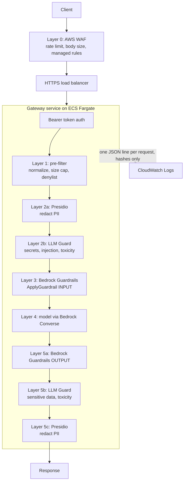

# Defense in Depth for LLM and Agentic Workflows

A reference implementation of layered security for LLM applications on AWS. It combines
open-source scanners (LLM Guard, Presidio) with Amazon Bedrock Guardrails behind a gateway
service, and ships the Terraform, CI/CD, and adversarial testing needed to run it.

No single control is trusted on its own. Each request passes through several independent
layers, ordered cheapest first, so obvious attacks are rejected before expensive checks run.

## Status

This is a working starting point, not a battle-tested product. What has and has not been
verified:

| Verified locally | Not verified |
|---|---|
| 98 unit tests pass; Terraform `fmt` and `validate` pass for both stacks | No `terraform plan` or `apply` against a real AWS account |
| Python dependency pins resolve under Python 3.12 | The Docker image has never been built |
| Garak config, auth, report parsing, and the pass/fail gate, against a local stub gateway | Real LLM Guard and Presidio model behavior; real Bedrock calls |
| Promptfoo config validates; `--strict` fails loudly; dataset plugins generate offline | Promptfoo's LLM-driven plugins and strategies (tested only with a fake model ID) |
| Workflow YAML parses | The GitHub Actions workflows have not run on GitHub |

## Architecture



Design choices worth knowing:

- **Fail closed.** If any layer raises an error, the request is blocked. A layer can only fail
  open if you list it in `FAIL_OPEN_LAYERS`, which is empty by default.
- **Presidio runs before the managed layer**, so PII is replaced with placeholders such as
  `<PERSON>` before text leaves your service boundary.
- **Generic block messages.** Callers are not told which layer rejected them.
- **No plaintext in audit logs.** Records hold a SHA-256 digest and length of each prompt and
  response, plus per-layer verdicts and timings.
- **Masking is not blocking.** Bedrock reports `GUARDRAIL_INTERVENED` for both. The gateway
  inspects the assessments so masked content continues and blocked content stops.

## Repository layout

| Path | Contents |
|---|---|
| `app/` | The gateway service (FastAPI), its Dockerfile, and 98 unit tests |
| `terraform/` | Root stack and modules: `guardrail`, `edge` (WAF), `audit` (KMS, logging, alerts), `gateway` (ECS and ALB) |
| `terraform/bootstrap/` | One-time setup: state bucket, GitHub OIDC roles, ECR repository, red-team role |
| `terraform/envs/` | Per-environment `tfvars` and backend config for `dev` and `prod` |
| `tests/guardrail/` | Regression cases run against the deployed Bedrock guardrail |
| `redteam/` | Promptfoo and Garak configs and the Garak gating script |
| `.github/workflows/` | CI/CD, regression, and red-team workflows |

## The gateway API

```http
POST /v1/chat
Authorization: Bearer <API_KEY>
Content-Type: application/json

{"prompt": "Explain the difference between TCP and UDP."}
```

```json
{"request_id": "5c1d...", "blocked": false, "response": "TCP is connection oriented..."}
```

- A blocked request still returns HTTP `200` with `"blocked": true` and a generic message.
- `401` for a missing or wrong token, `422` for an invalid body, `502` if the model call fails.
- `GET /healthz` returns `503` while models load and `200` when ready. It needs no auth.
- API docs endpoints are disabled.

### Configuration

All settings are environment variables. Required: `API_KEY`, `GUARDRAIL_ID`,
`GUARDRAIL_VERSION`, `MODEL_ID`, `AWS_REGION`. Terraform sets these on the ECS task; the API
key comes from Secrets Manager.

| Variable | Default | Purpose |
|---|---|---|
| `MAX_PROMPT_CHARS` | `8000` | Pre-filter size limit |
| `BLOCK_ENCODED_BLOBS` | `true` | Reject long base64-like strings |
| `PII_ENTITIES` | person, email, phone, card, SSN, and others | Presidio entity types |
| `INJECTION_THRESHOLD` | `0.9` | LLM Guard prompt-injection threshold |
| `TOXICITY_THRESHOLD` | `0.7` | LLM Guard toxicity threshold |
| `FAIL_OPEN_LAYERS` | empty | Comma-separated layer names allowed to fail open |
| `SYSTEM_PROMPT` | generic assistant prompt | System prompt for the model |

The two thresholds are starting guesses, not tuned values. Replay real traffic and adjust.

## Getting started

### Run the tests locally

```bash
cd app
pip install -r requirements-dev.txt   # or just: pip install fastapi pydantic httpx pytest
pytest
```

The tests fake LLM Guard, Presidio, and AWS, so they need no credentials, models, or network.
Python 3.12 is required to install the full `requirements.txt` (LLM Guard supports 3.10 to
3.12 only).

### Deploy

1. **Bootstrap** (once per AWS account, with admin credentials):

   ```bash
   cd terraform/bootstrap
   terraform init
   terraform apply -var github_repository=<owner>/<repo> -var 'environments=["dev"]'
   ```

   Use `["dev","prod"]` if both share one account. It outputs the state bucket, the plan and
   apply role ARNs, the ECR repository URL, and the red-team role ARN.

2. **Point the backends at your state bucket.** Replace the placeholder bucket name in
   `terraform/envs/dev.backend.hcl` and `prod.backend.hcl`.

3. **Create GitHub Environments** named `dev` and `prod`. Add required reviewers to `prod` so
   production deploys wait for approval.

4. **Set GitHub variables:**

   | Scope | Variable | Value |
   |---|---|---|
   | Repository | `AWS_REGION` | for example `us-east-1` |
   | Repository | `AWS_PLAN_ROLE_ARN_DEV`, `AWS_PLAN_ROLE_ARN_PROD` | `plan_role_arn` from bootstrap |
   | Each environment | `AWS_APPLY_ROLE_ARN` | that environment's entry in `apply_role_arns` |

5. **Enable the gateway.** It is off by default (`enable_gateway = false`). Create the API key
   secret in Secrets Manager yourself so it never enters Terraform state, then fill in the
   commented gateway block in `terraform/envs/<env>.tfvars` (VPC, subnets, certificate, model
   ID and ARNs, secret ARN) and set `enable_gateway = true`.

6. **Merge to `main`.** The pipeline builds the image, deploys to dev, runs the guardrail
   regression suite, then waits for approval before prod.

### Things to configure before relying on it

- **Model access.** `model_resource_arns` must include every ARN the model call can route to
  (the model and, if you use one, the inference profile). Missing ARNs cause access-denied
  errors at runtime.
- **STANDARD guardrail tier** uses cross-region inference. It is off by default. Check your
  data residency requirements before setting `guardrail_profile_arn`.
- **Bedrock invocation logging** is a singleton per account and region and stores blocked
  content in plaintext. Set `enable_invocation_logging = false` if another stack owns it.
  The log group is encrypted with a customer-managed key on short retention.

## CI/CD workflows

| Workflow | Trigger | What it does |
|---|---|---|
| `terraform-ci` | Pull request | `fmt`, `validate`, TFLint, Checkov, and a plan per environment posted as a PR comment |
| `app-ci` | Pull request touching `app/` or `redteam/` | `ruff`, byte-compile, unit tests, red-team config checks |
| `terraform-deploy` | Push to `main` | Build image, deploy dev, test, then (after approval) build, deploy, and test prod |
| `_build-image`, `_terraform-apply` | Called by deploy | Build, push, and ECR-scan the image; apply a saved plan |
| `guardrail-tests` | After each deploy, weekly, manual | Runs `tests/guardrail/cases.yaml` against the deployed guardrail; opens an issue if the weekly run fails |
| `redteam` | Weekly, manual | Promptfoo and Garak against the dev gateway; see below |

AWS access uses GitHub OIDC, so no long-lived keys are stored. Plan runs use a read-only role
limited to pull requests; apply runs use a per-environment role that only jobs in that
GitHub Environment can assume.

Checkov currently runs with `soft_fail: true` so the first results can be triaged. Remove it
once the baseline is clean so findings gate merges. Actions are pinned by tag, not commit
SHA; pin to SHAs for a stricter supply chain.

## Red teaming

`.github/workflows/redteam.yml` attacks the **dev** gateway each week:

- **Promptfoo** generates attacks and grades results with a Bedrock model in your account.
  Remote generation is disabled, so no prompts or responses go to Promptfoo's hosted service,
  and only plugins that run locally are used. It generates with `--strict` so a plugin that
  cannot run fails the job instead of being silently skipped. The job fails below a pass rate
  (default 90%).
- **Garak** runs about 2,700 requests across prompt-injection, jailbreak, encoding,
  system-prompt-extraction, and credential-leak probes, and fails any probe where more than
  10% of attempts breach the gateway.

Setup needed:

- The gateway load balancer is internal by default, so GitHub-hosted runners cannot reach it.
  Set the repository variable `REDTEAM_RUNNER` to a self-hosted runner inside your network.
- Put that runner's egress address in `redteam_source_cidrs` in `dev.tfvars`. It bypasses the
  WAF so the rate limit does not distort results. Terraform refuses this setting in `prod`.
- In the `dev` environment, set the variables `REDTEAM_GATEWAY_URL`, `REDTEAM_ROLE_ARN`, and
  `REDTEAM_MODEL_ID`, and the secret `REDTEAM_GATEWAY_API_KEY`.

Expect each weekly run to make roughly 2,700 model calls through the dev gateway plus the
attack-generation and grading calls, so it has a real cost.

## Known limitations

- **No Llama Guard or NeMo Guardrails.** Llama Guard needs a GPU or separate model host, and
  NeMo needs flows written for your use case. New layers implement the `Layer` protocol in
  `app/gateway/pipeline.py`.
- **Single-turn only.** There is no session memory, multi-turn tracking, or tool-call control.
  The red-team tooling can test those once an agent loop exists.
- **The apply role is broad** (`bedrock:*`, `kms:*`, and similar on `*`). Tighten it with your
  naming conventions.
- **ALB access logs are off**, and task egress defaults to port 443 anywhere. Add a logging
  bucket and narrow egress with VPC endpoints.
- **Model accuracy is not measured.** The unit tests check that the code interprets scanner
  results correctly, not that LLM Guard or Presidio detect attacks well. A labeled evaluation
  set run against the built image would measure that.

## Dependency updates

Dependabot (`.github/dependabot.yml`) opens grouped weekly pull requests for the gateway and
test Python dependencies, the Docker base image, Terraform providers, and GitHub Actions.
Security updates open immediately. Three things are intentionally not automated:

- **Presidio** is pinned to the exact version LLM Guard requires. Update it together with
  `llm-guard`, by hand.
- **The Python base image** stays on 3.12 because LLM Guard does not support newer versions.
  Dependabot only takes patch releases.
- **Promptfoo, Garak, and torch** are pinned inside workflow and Dockerfile commands, which
  Dependabot cannot see. Bump `PROMPTFOO_VERSION`, `GARAK_VERSION`, and the torch pin by hand.

## License

[MIT](LICENSE)
